# Road Inspection Assistant

A read-only, natural-language way into RoadSense for inspectors and administrators. You ask a question in plain
language ("Which potholes near schools are overdue?") and get an answer built from RoadSense's own records. The
answer says what it is based on, which records it cites, when they were read, and what is unknown.

It is not a general chatbot. It answers only from the data RoadSense holds, it cannot change anything, and when the
records are not enough it says so: *"I could not find sufficient information in the available RoadSense records to
answer this question reliably."*

## Where it lives in the app

The assistant is not a page. An **Ask RoadSense** button sits at the bottom right of every signed-in page, and
**Ctrl/⌘ I** (or "Ask the assistant" in the command palette) does the same. It opens a panel on the right:

- **From 1440 px wide** the panel docks and pushes the page over, so the page and the conversation sit side by side.
  Narrower screens show it over the page, and phones show a full-screen sheet with a round launcher.
- **It stays open while you move between pages.** A report link in an answer opens that report behind the panel. On
  a phone the sheet closes first, so you see the report.
- **Header:** your conversations (a history view inside the panel, with delete), new conversation, and close
  (Esc returns focus to where you were).
- **Answers:** the answer text, then the key figures, warnings, and one result card per record. On cards the first
  field names the record and the others are labelled; a line above the cards names the calculated and forecast fields.
  Map, Evidence and Limitations are collapsible sections; the map is built only when opened, from exactly the
  records in the answer, with damage, severity, status and risk filters.
- The open state and current conversation are remembered in the browser, so a reload brings the panel back.
  Old `#/assistant` links open the panel over the Overview.

## What you can ask

| Category | Example | Answered from |
|---|---|---|
| Road damage | "Show me the five most severe potholes reported in Halifax during the last 30 days" | `reports`, `events` |
| Counts by road | "Which roads have the highest number of potholes?" | `reports` |
| Workflow status | "Which repairs are overdue?" (past the estimated repair date), "potholes awaiting inspection", "which defects need repair", "which potholes have been repaired", "which reports are still open" | `reports` (status, `repair_eta`) |
| Repeated damage | "Which locations have experienced repeated damage?" | trips, drivers, reopenings |
| Deterioration | "Which road segments have both severe damage and increasing deterioration?" | `condition.deterioration` |
| Road condition | "Which road segments are in the worst condition?" | `condition.segments` (an estimate) |
| Repair verification | "Which completed repairs have not been independently verified?" | `repair.*`, `repair_verifications` |
| Repair history | "Their repair history" (after a list), "repair history of #12" | `repair_verifications`, `service_clocks` |
| Repair performance | "Average time between repair completion and defect recurrence?", "Compare repair performance across neighbourhoods" | closures and reopenings |
| Service standards | "Which reports are overdue against the service standard?", "…approaching their service deadlines?", "…waiting for an authority response?" | `service_standards.dashboard` |
| Risk | "Which roads have the highest risk scores?", "High-risk roads near schools or public transport?" | `exposure.listing` |
| Recommendations | "Which five road segments should our inspection team investigate first?" | existing risk score, deadlines, trend |
| Freeze-thaw | "Which roads may be affected by upcoming freeze-thaw conditions?" | `forecast.latest` (a heuristic) |
| A report | "Show report #12" | everything above for one report |

Follow-ups work within a conversation: "Show only those near schools", "Which of them have overdue reports?",
"The first three", "Their repair history". A follow-up narrows the **ids** of the previous answer and re-reads them
from the database, so it never reuses stale rows.

Suggested questions in the panel appear only for capabilities that have data. On a fresh install with no filed
reports, the panel does not suggest service-standard questions, and if you ask one anyway it says no report has been
filed yet.

### What it will not do

- **Change anything.** "Approve #3", "close the defect on Barrington Street", "change the deadline" and similar
  requests are refused. The refusal points to the page where that change is made, with role checks and an explicit
  confirmation.
- **Judge repair methods or materials.** RoadSense does not record repair types, so durability by type is reported as
  unavailable instead of guessed.
- **Invent deadlines, scores or forecasts.** Deadlines come only from configured, verified service-standard rules.
  Unverified rules are shown as provisional and not counted. Risk scores come from the exposure service and forecasts
  from the freeze-thaw forecast.
- **Treat missing data as a "no".** An empty result says that RoadSense only knows what its trips and the
  authorities' updates recorded. Unknown weather is shown as unknown, never as zero.

## Architecture and data flow

```mermaid
flowchart LR
  U[Inspector in the web app] -- signed-in session, CSRF --> BFF[Web BFF /api/assistant/*]
  BFF -- service token + X-RoadSense-User/Role --> API[Agent API /assistant/*]
  API --> H[Query handler: validate, rate-limit, owner check]
  H --> QU[Query understanding]
  QU -- rules first --> SPEC[(QuerySpec: validated schema)]
  QU -. only when the rules can't tell .-> LLM1{{LLM: returns JSON}} -. validated .-> SPEC
  SPEC --> R[Retrieval: one fixed function per intent]
  R --> CORE[core: reports, repair, service_standards, exposure, forecast, condition]
  R --> RES[Result: rows, ids, metrics, warnings, map points]
  RES --> COMP[Answer composed in code]
  RES --> CTX[Context builder: allow-listed fields] -. optional .-> LLM2{{LLM summary}} -. ids + numbers checked .-> OUT
  COMP --> OUT[Structured response]
  OUT --> STORE[(assistant_conversations / assistant_messages: text + ids only)]
  OUT --> AUD[(audit: intent, counts — not the question)]
```



The code is in `roadsense/assistant/`:

| Module | Responsibility |
|---|---|
| `spec.py` | `QuerySpec`, the only thing understanding may hand to retrieval. Enums, bounded numbers, dates and a short location string; unknown fields are rejected |
| `understanding.py` | Rule parser (intent, location, dates, damage class, severity, limit, follow-ups, change requests). In `auto` mode the LLM is asked only when the rules cannot recognise the question, and its JSON is accepted only if it validates |
| `retrieval.py` | One read-only function per intent over the existing core modules; per-question memo so each source is read once |
| `context.py` | The compact context a model may see: allow-listed fields, at most `ROADSENSE_ASSISTANT_CONTEXT_ROWS` rows |
| `response.py` | Answer text composed from the rows; the optional model summary and its grounding check |
| `store.py` | Conversations scoped to their owner |
| `service.py` | The handler: input checks, rate limit, ownership, understanding → retrieval → answer → storage → audit |

### Observed, calculated, predicted

Every answer carries a `kind`, and the panel labels it. Metrics are tagged **calc** (a RoadSense calculation) or
**forecast**, and a line above the result cards names the calculated and forecast fields:

- **Observed**: detections, dates, statuses, verification results as stored.
- **Calculated**: severity band, risk scores, condition index, service-standard status, trends.
- **Predicted**: the freeze-thaw forecast (a heuristic, not a validated model).
- **AI interpretation**: the optional model summary, in its own labelled box, never used as the answer itself.

### Explainable recommendations

"Which locations should we inspect first?" ranks open reports, plus reports reopened after a closure, by the
**existing** exposure-weighted overall risk score. Ties, and reports without a score, are ordered by an overdue or
approaching service standard, a worsening trend, the severity band, independent drivers and the report's RoadSense
priority. Each row lists why it is ranked there (for example "overall risk 0.81 (critical) from physical damage
severity, cyclist exposure; seen on 3 trips by 2 drivers; getting worse"). If any candidate has no risk score, the
answer says the recommendation is incomplete. The assistant never computes a score of its own.

## Hallucination safeguards

1. Facts come from fixed query functions, never from the model. The model cannot write SQL or call functions.
2. The model's interpretation must validate as a `QuerySpec`. A location containing `;`, a quote or SQL is rejected,
   as is an unknown intent or field, a limit over 50, or reversed dates. If validation fails, the rule parser's
   reading is used.
3. The answer text is composed in code from the retrieved rows.
4. The optional summary is shown only if every `#id` it cites was retrieved, every figure in it appears in the
   context it was given, and it contains no configured secret. Otherwise it is dropped, and a warning says why
   without repeating the invented value.
5. Every answer returns the cited report ids, per-record evidence (first detection, observations, trips, drivers,
   photo, coordinates, risk factors), sources, method and `retrieved_at`.
6. Empty results and missing data are worded as "not found in RoadSense", never as a negative finding.
7. Authority actions are reported only from authority records (service clocks, statuses). The assistant never says a
   repair was done without them.

## Security

| Control | How |
|---|---|
| Authentication | The web BFF requires a signed-in session; the agent API requires the service token **and** a named user (`X-RoadSense-User`) with a known role |
| Roles | Every role with `read` permission (admin, reviewer, driver, viewer) may ask. Answers use the same data those roles already see on the dashboards. Staff names from the duty-of-care ledger, which is reviewers only, are never used |
| Conversation privacy | Every read, follow-up and delete checks the owner; another person's conversation id answers 404 |
| Read-only | No code path writes a RoadSense record. Change requests, at the start of any sentence or after "then", are refused before any model call |
| Prompt injection | The question is data in a JSON envelope; the model's output is a schema-validated spec or a checked summary. Report descriptions, authority notes, addresses and coordinates never go to the model |
| SQL injection | Filters are bound parameters or Python comparisons; there is no SQL built from text |
| Secrets | Summaries containing configured secrets are dropped; no setting or key is ever in a response |
| Rate limit | `ROADSENSE_ASSISTANT_RATE_PER_MIN` questions per person per minute, plus the agent API's global limit |
| Logging | The audit row records intent, result counts, whether a summary was shown and the role. The question text is not logged; the person's own conversation holds it |
| Data residency | The assistant uses the same OpenRouter client and `ROADSENSE_DATA_RESIDENCY` checks as the agents |

Organisation-level restrictions: RoadSense has no tenant model today (one deployment per authority), so all
signed-in roles see the same records. If tenants are added, `retrieval.load_reports` is the single place to scope them.

## API

Web app (browser, signed-in session; changes need `X-CSRF-Token`):

| Method | Path | Purpose |
|---|---|---|
| GET | `/api/assistant/capabilities` | What can be answered now, and suggestions for it |
| POST | `/api/assistant/chat` | `{"question": "...", "conversation_id": "optional"}` → structured answer |
| GET | `/api/assistant/conversations` | Your conversations |
| GET | `/api/assistant/conversations/{id}` | One of your conversations, with its messages |
| DELETE | `/api/assistant/conversations/{id}` | Delete your chat history (no RoadSense record changes) |

The agent API exposes the same paths without the `/api` prefix (`/assistant/...`), behind the service token.

Chat response:

```json
{
  "conversation_id": "5663b26355832ebb", "message_id": 2, "question": "Which reports are overdue?",
  "intent": "service_standards", "understanding": "rules",
  "interpretation": ["Service standards", "service status overdue", "up to 10 results"],
  "spec": {"intent": "service_standards", "service_status": ["overdue"], "limit": 10, "...": "..."},
  "answer": {"text": "Based on RoadSense records retrieved …", "kind": "calculated", "insufficient": false},
  "narrative": null,
  "metrics": [{"label": "Overdue", "value": 2, "kind": "calculated"}],
  "table": {"columns": [{"key": "report_id", "label": "Report", "kind": "observed"}], "rows": ["..."]},
  "report_refs": [12, 7], "segment_refs": [],
  "map": {"points": [{"report_id": 12, "lat": 44.65, "lon": -63.58, "label": "Pothole #12", "status": "repair_needed"}]},
  "evidence": [{"report_id": 12, "first_seen": "…", "observations": 3, "trips": 2, "photo_event_id": "…"}],
  "warnings": [], "limitations": ["Compliance monitoring and evidence management only. …"],
  "method": "Deadlines: end of the N-th business day …", "sources": ["service_clocks", "service_standards"],
  "matched": 2, "retrieved_at": "2026-11-25T14:02:11+00:00", "read_only": true
}
```

## Storage

Two new tables (created on connect, like every other RoadSense table, no separate migration step):

- `assistant_conversations (id, owner, title, created_at, updated_at)`
- `assistant_messages (id, conversation_id, role, content, intent, spec, result_ids, segment_ids, warnings,
  understanding, retrieved_at, created_at)`

Only the question, the answer text, the validated spec and the cited ids are stored. Record copies are never
stored, so reports stay the single source of truth. A reopened conversation shows each earlier answer as a dated
snapshot. Query logging reuses the existing append-only `audit` table (`assistant_query`,
`assistant_conversation_deleted`).

## Configuration

| Variable | Default | Meaning |
|---|---|---|
| `ROADSENSE_ASSISTANT` | `1` | `0` turns the assistant off (503) |
| `ROADSENSE_ASSISTANT_UNDERSTANDING` | `auto` | `rules`: built-in parser only; `auto`: the LLM only for questions the rules cannot read; `llm`: LLM first, rules as fallback |
| `ROADSENSE_ASSISTANT_NARRATIVE` | `1` | Ask the LLM for a short, checked summary of the records |
| `ROADSENSE_ASSISTANT_MODELS` | `ROADSENSE_LLM_MODELS` | Model fallback chain for the assistant |
| `ROADSENSE_ASSISTANT_LLM_TIMEOUT_S` | `20` | Per model call; on timeout the answer is given without the model |
| `ROADSENSE_ASSISTANT_MAX_TOKENS` | `500` | Summary length budget |
| `ROADSENSE_ASSISTANT_MAX_ANSWER_CHARS` | `1200` | Summary is cut to this length |
| `ROADSENSE_ASSISTANT_CONTEXT_ROWS` | `15` | Most rows a model sees |
| `ROADSENSE_ASSISTANT_RATE_PER_MIN` | `12` | Questions per person per minute |

**Provider.** The assistant reuses the existing OpenRouter client (`roadsense/agents/llm.py`): `OPENROUTER_API_KEY`,
`OPENROUTER_BASE_URL`, the response cache and the data-residency rules. No new provider or dependency is added.
Without a key, or with `ROADSENSE_USE_LLM=0`, everything still works: the rules read the question and code writes the
answer. The model is optional because it is not needed for filtering or counting. It adds value only for unusual
phrasings and for a readable summary. For production, point `OPENROUTER_BASE_URL` at a Canadian, no-retention,
OpenAI-compatible endpoint and set `ROADSENSE_DATA_RESIDENCY=ca`.

**Cost.** Most questions make no model call (`auto` mode). A question with a summary makes one call of at most
`ROADSENSE_ASSISTANT_MAX_TOKENS` output tokens over at most 15 compact rows. With the default cache mode, an
identical question over unchanged records costs nothing.

## Known limitations

- The rule parser covers the question categories above in English. Unusual phrasings need the LLM (`auto` mode) or a
  rephrase. When neither recognises the question, the assistant says so.
- Location matching is a substring match on stored road names, addresses, municipalities and neighbourhoods.
  There is no gazetteer, so "downtown" matches only if a neighbourhood is called that. Map-area selection is not
  supported yet.
- Trends need two or more passes over the same defect. Single sightings are reported as "trend unknown".
- Repair types, materials and crews are not recorded, so durability by method cannot be answered.
- No tenant or organisation model exists, so all signed-in roles see the same records.
- Conversations are kept until their owner deletes them; they are not yet covered by the retention job.

Future improvements: a road-name gazetteer from OSM for fuzzy location matching; map-area (bounding box) questions
from the Map page; retention for conversations; recording repair types so performance by method becomes answerable;
streaming responses.

## Testing

```bash
python -m pytest tests/test_assistant.py -q      # understanding, retrieval, grounding, follow-ups, security
python scripts/check.py                          # lint + the whole suite
```

The tests never call a real model: scripted fakes return valid specs, invalid JSON, hostile output, ungrounded
summaries, secrets and timeouts, and the tests check that each is handled. OpenStreetMap is mocked with
`httpx.MockTransport`.

## Example session

> **Which roads currently have the highest risk scores?**
> Based on RoadSense records retrieved 2026-11-25 14:02 UTC, 3 record(s) match. Top: #12 Pothole on Quinpool Road
> (overall 0.81, critical, near School, Bus stop); … *Calculated* · table, map, evidence, limitations.
>
> **Show only those near schools.** → the same three ids re-read and filtered by nearby schools.
>
> **Which of them have overdue reports?** → service-standard status of those ids, from the configured rules.
>
> **Approve them.** → refused: the assistant is read-only.

(Illustrative wording only: real answers show whatever the records hold.)
